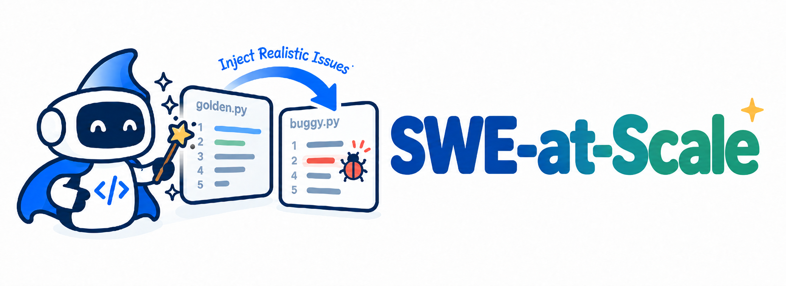

<div align="center">
  
  <h1>🧪 SWE-at-Scale: Scalable Issue Synthesis from Historical Bug Fixes </h1>
  <p><strong>Realistic issue injection for SWE-style benchmarks</strong></p>
  <p>Generate behaviorally meaningful buggy states from correct code, validate the resulting patch, and keep the complete provenance of each run.</p>
</div>

## 🧭 Overview

SWE-at-Scale packages two complementary issue-injection methods behind one small
command-line interface. **SWE-at-Scale** directly proposes a behaviorally meaningful
issue patch, while **SWE-at-Scale+** first creates a structured plan and then
uses an executor to implement it. Both methods start from verified, correct
source code and produce an injected file plus a unified diff that can be
applied to the original source.


### 🔀 What is different

| Mode | Model interaction | Final artifact |
|---|---|---|
| **SWE-at-Scale** | The model sees the fixed source with reference line numbers and directly proposes an issue patch. | `<issue_patch>` → injected file + unified diff |
| **SWE-at-Scale+** | A planner proposes a structured implementation plan; a separate executor implements that plan in the fixed source. | planner output → modified source → injected file + unified diff |

The planner decides the task. The executor implements the plan. Keeping these
roles separate is important: the executor is not asked to invent a different
bug after seeing the plan.

## 📦 Installation

Python 3.10 or newer is required.

```bash
git clone <repository-url>
cd SWE-at-scale
python -m venv .venv
source .venv/bin/activate
python -m pip install -U pip
python -m pip install -e .
```

The client uses the official OpenAI SDK defaults when no runtime endpoint
override is supplied. For another OpenAI-compatible server, set the endpoint
through an environment variable at runtime; no provider-specific URL is stored
in this repository.

## 🚀 Quick start

Set a credential and the model identifiers in the shell that launches SWE-at-Scale.
They are intentionally not stored in configuration files or output metadata.

```bash
export OPENAI_API_KEY='your-key'
```

The example source is deliberately small and contains no repository-specific
information:

```text
examples/fixed_context.py
```

### 🧩 SWE-at-Scale

The input file itself remains unnumbered. Reference numbers are added only to
the model prompt, and the returned patch must apply to the original source
without those prefixes.

```bash
export SWE_AT_SCALE_MODEL='your-model'

swe-at-scale direct \
  --model "$SWE_AT_SCALE_MODEL" \
  --input examples/fixed_context.py \
  --output-dir outputs/swe_at_scale
```

The model must return exactly:

```text
<issue_patch>
diff --git a/fixed_context.py b/fixed_context.py
...
</issue_patch>
```

### ✨ SWE-at-Scale+

The planner returns a structured implementation plan and a natural language
problem statement. Only the plan is passed to the executor, which returns the
complete modified file.

```bash
export SWE_AT_SCALE_PLUS_PLANNER_MODEL='your-planner-model'
export SWE_AT_SCALE_PLUS_EXECUTOR_MODEL='your-executor-model'

swe-at-scale plus \
  --planner-model "$SWE_AT_SCALE_PLUS_PLANNER_MODEL" \
  --executor-model "$SWE_AT_SCALE_PLUS_EXECUTOR_MODEL" \
  --input examples/fixed_context.py \
  --output-dir outputs/swe_at_scale_plus
```

The executor receives the fixed source and the structured plan.

The expected executor format is:

```text
<modified_file>
...complete modified source file...
</modified_file>
```

## ✅ Validation and safety checks

Every generated result passes the same local validation sequence:

1. exactly one target file is changed;
2. the patch is applied with `git apply`;
3. if the first apply fails, the runner retries with `git apply --recount`;
4. the resulting file is checked by a reverse-apply roundtrip;
5. only then are `injected_file` and `injection.patch` marked successful.

The package does not run a repository-wide test suite. Repository-level Docker
evaluation and benchmark orchestration are intentionally outside this minimal,
public release.

## 📁 Output layout

Each run writes only relative artifact names inside the requested output
directory:

```text
messages.json                 # sanitized prompt messages
planner_messages.json         # SWE-at-Scale+ only
executor_messages.json        # SWE-at-Scale+ only
model_raw_output.txt          # SWE-at-Scale only
planner_raw_output.txt        # SWE-at-Scale+ only
executor_raw_output.txt       # SWE-at-Scale+ only
modified_file                 # SWE-at-Scale+ only
injected_file                 # validated issue-state file
injection.patch               # validated unified diff
result.json                   # status, patch statistics, and validation details
```

`result.json` records the selected model identifier but never records API keys,
runtime credentials, absolute input paths, or endpoint values.

## ⚙️ Runtime configuration

The following values are runtime-only:

| Variable | Purpose |
|---|---|
| `OPENAI_API_KEY` | API credential |
| `OPENAI_BASE_URL` | Optional OpenAI-compatible endpoint override |
| `OPENAI_MODEL` | Fallback model identifier |
| `SWE_AT_SCALE_MODEL` | SWE-at-Scale model identifier |
| `SWE_AT_SCALE_PLUS_PLANNER_MODEL` | SWE-at-Scale+ planner model identifier |
| `SWE_AT_SCALE_PLUS_EXECUTOR_MODEL` | SWE-at-Scale+ executor model identifier |

Command-line model options override the corresponding environment variables.
Never commit a real `.env` file or generated output containing proprietary
source code.

## 🗂️ Repository structure

```text
SWE-at-scale/
├── assets/
│   ├── SWE-at-Scale_logo.png
│   ├── framework.pdf
│   └── framework.png
├── examples/
│   └── fixed_context.py
├── src/swe_at_scale/           # provider client, CLI, pipelines, validation
├── tests/
├── .env.example
├── .gitignore
├── pyproject.toml
└── README.md
```

## 🙏 Acknowledgements

We thank the authors and maintainers of [SWE-smith](https://github.com/SWE-bench/SWE-smith)
and [SWE-bench](https://github.com/SWE-bench/SWE-bench) for their open-source
benchmark resources and evaluation foundations, which informed the design of
SWE-at-Scale and SWE-at-Scale+.
