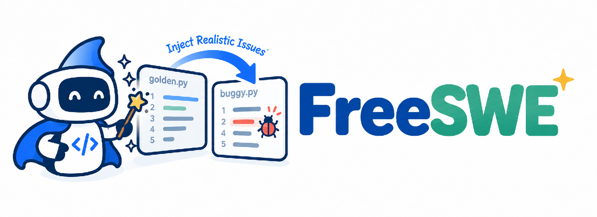
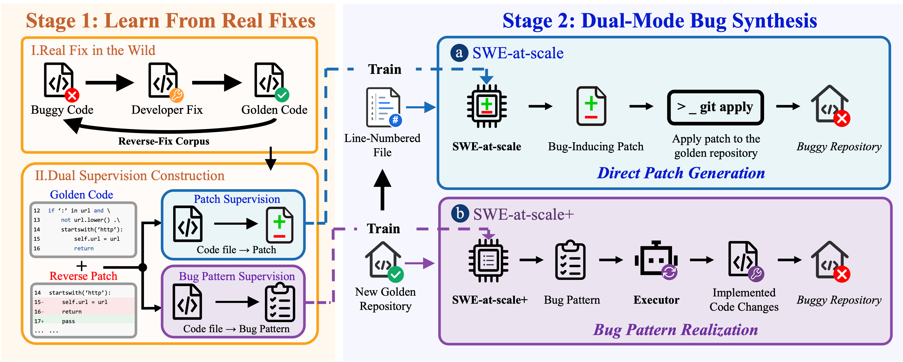

<div align="center">
  
  <h1>🧪 FreeSWE &amp; FreeSWE-Plus</h1>
  <p><strong>Realistic issue injection for SWE-style benchmarks</strong></p>
  <p>Generate behaviorally meaningful buggy states from correct code, validate the resulting patch, and keep the complete provenance of each run.</p>
</div>

## 🧭 Overview

FreeSWE packages two complementary issue-injection methods behind one small
command-line interface. **FreeSWE** directly proposes a behaviorally meaningful
issue patch, while **FreeSWE-Plus** first creates a structured plan and then
uses an executor to implement it. Both methods start from verified, correct
source code and produce an injected file plus a unified diff that can be
applied to the original source.



The vector figure is available as [PDF](assets/framework.pdf).

### 🔀 What is different

| Mode | Model interaction | Final artifact |
|---|---|---|
| **FreeSWE** | The model sees the fixed source with reference line numbers and directly proposes an issue patch. | `<issue_patch>` → injected file + unified diff |
| **FreeSWE-Plus** | A planner proposes a structured implementation plan and problem statement; a separate executor implements that plan in the fixed source. | planner output → modified source → injected file + unified diff |

The planner decides the task. The executor implements the plan. Keeping these
roles separate is important: the executor is not asked to invent a different
bug after seeing the plan.

## 📦 Installation

Python 3.10 or newer is required.

```bash
git clone <repository-url>
cd FreeSWE
python -m venv .venv
source .venv/bin/activate
python -m pip install -U pip
python -m pip install -e .
```

The client uses the official OpenAI SDK defaults when no runtime endpoint
override is supplied. For another OpenAI-compatible server, set the endpoint
through an environment variable at runtime; no provider-specific URL is stored
in this repository.

## 🚀 Quick start

Set a credential and the model identifiers in the shell that launches FreeSWE.
They are intentionally not stored in configuration files or output metadata.

```bash
export OPENAI_API_KEY='your-key'
```

The example source is deliberately small and contains no repository-specific
information:

```text
examples/fixed_context.py
```

### 🧩 FreeSWE

The input file itself remains unnumbered. Reference numbers are added only to
the model prompt, and the returned patch must apply to the original source
without those prefixes.

```bash
export FREESWE_MODEL='your-model'

freeswe free-swe \
  --model "$FREESWE_MODEL" \
  --input examples/fixed_context.py \
  --output-dir outputs/free_swe
```

The model must return exactly:

```text
<issue_patch>
diff --git a/fixed_context.py b/fixed_context.py
...
</issue_patch>
```

### ✨ FreeSWE-Plus

The planner returns both a structured implementation plan and a natural
language problem statement. The executor receives the fixed source and the
plan, then returns the complete modified file. The problem statement is saved
but is not passed to the executor by default; use the flag only for an
intentional problem-statement variant.

```bash
export FREESWE_PLUS_PLANNER_MODEL='your-planner-model'
export FREESWE_PLUS_EXECUTOR_MODEL='your-executor-model'

freeswe free-swe-plus \
  --planner-model "$FREESWE_PLUS_PLANNER_MODEL" \
  --executor-model "$FREESWE_PLUS_EXECUTOR_MODEL" \
  --input examples/fixed_context.py \
  --output-dir outputs/free_swe_plus
```

The planner returns a structured implementation plan and a realistic problem
statement. The executor receives the fixed source and the structured plan.

The expected executor format is:

```text
<modified_file>
...complete modified source file...
</modified_file>
```

## ✅ Validation and safety checks

Every generated result passes the same local validation sequence:

1. exactly one target file is changed;
2. the patch is applied with `git apply`;
3. if the first apply fails, the runner retries with `git apply --recount`;
4. the resulting file is checked by a reverse-apply roundtrip;
5. only then are `injected_file` and `injection.patch` marked successful.

The package does not run a repository-wide test suite. Repository-level Docker
evaluation and benchmark orchestration are intentionally outside this minimal,
public release.

## 📁 Output layout

Each run writes only relative artifact names inside the requested output
directory:

```text
messages.json                 # sanitized prompt messages
planner_messages.json         # FreeSWE-Plus only
executor_messages.json        # FreeSWE-Plus only
model_raw_output.txt          # FreeSWE only
planner_raw_output.txt        # FreeSWE-Plus only
executor_raw_output.txt       # FreeSWE-Plus only
problem_statement.txt         # FreeSWE-Plus only, when returned
modified_file                 # FreeSWE-Plus only
injected_file                 # validated issue-state file
injection.patch               # validated unified diff
result.json                   # status, patch statistics, and validation details
```

`result.json` records the selected model identifier but never records API keys,
runtime credentials, absolute input paths, or endpoint values.

## ⚙️ Runtime configuration

The following values are runtime-only:

| Variable | Purpose |
|---|---|
| `OPENAI_API_KEY` | API credential |
| `OPENAI_BASE_URL` | Optional OpenAI-compatible endpoint override |
| `OPENAI_MODEL` | Fallback model identifier |
| `FREESWE_MODEL` | FreeSWE model identifier |
| `FREESWE_PLUS_PLANNER_MODEL` | FreeSWE-Plus planner model identifier |
| `FREESWE_PLUS_EXECUTOR_MODEL` | FreeSWE-Plus executor model identifier |

Command-line model options override the corresponding environment variables.
Never commit a real `.env` file or generated output containing proprietary
source code.

## 🗂️ Repository structure

```text
FreeSWE/
├── assets/
│   ├── FreeSWE_logo.png
│   ├── framework.pdf
│   └── framework.png
├── examples/
│   └── fixed_context.py
├── src/freeswe/                # provider client, CLI, pipelines, validation
├── tests/
├── .env.example
├── .gitignore
├── pyproject.toml
└── README.md
```

## 🛠️ Development

```bash
python -m pip install -e .
python -m pytest -q
```

The test suite uses a fake model client and makes no network requests.

## 📌 Scope and limitations

- Current release focuses on one target source per run.
- The code does not bundle model checkpoints or select a particular hosted
  model automatically.
- The code does not include benchmark data, Docker images, repository clones,
  or repo-bounded evaluation infrastructure.
- Broader repository orchestration can be added later without changing the two
  output contracts.
